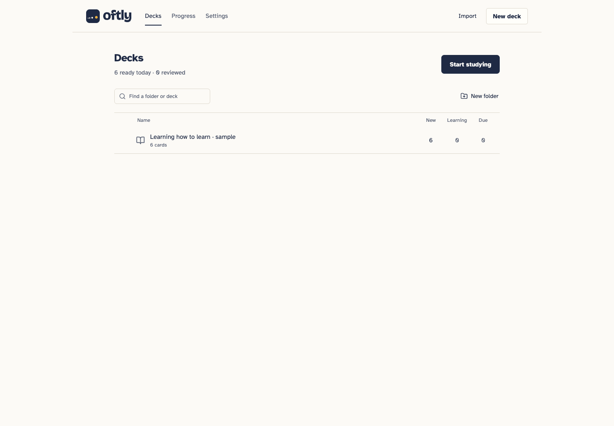
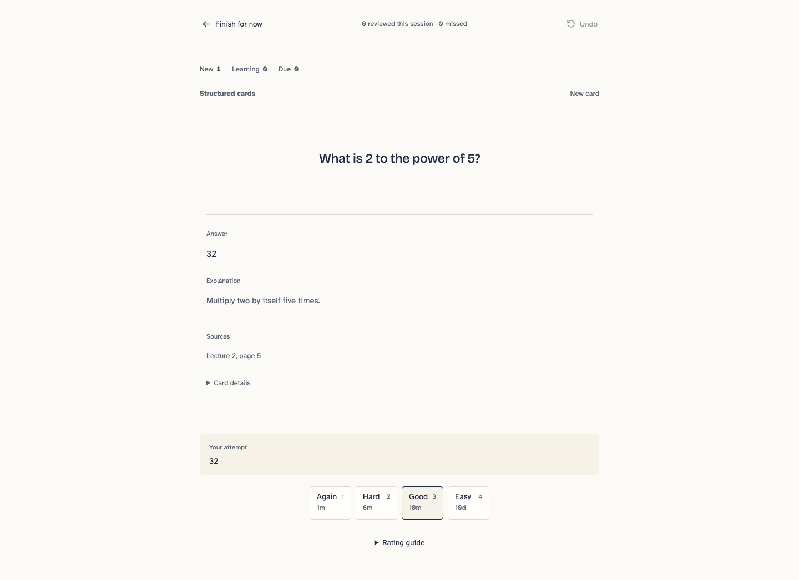

# Oftly

**A calmer way to study. Serious spaced repetition, simple flashcards, and cards you can take with you.**

Built by [Vivan Taneja](https://github.com/vivantaneja) and [Ashvant (@MilesatAshvantAnand)](https://github.com/MilesatAshvantAnand).

We built Oftly during our study period because we were fed up with how difficult Anki was to navigate, while Quizlet’s repetition didn’t feel rigorous enough for the way we wanted to learn. We wanted Anki’s memory scheduling in an interface that made sense immediately, with room to rethink how good flashcards are made.

Oftly is a local-first React web app. The **public browser edition** uses FSRS-6 and stores cards, review history and media in IndexedDB on each device. The **local native edition** uses the official Anki engine and a real Anki collection. Neither needs an account, analytics or an AI API key.



## Features

- **FSRS scheduling:** retrieve, reveal, compare and rate. New / Learning / Due counts, a missed-answer tally and countdown to the next repeat. Real interval previews, compact Again/Hard/Good/Easy buttons, keyboard shortcuts and undo.
- **Anki and Quizlet imports:** preview modern/legacy APKG packages, or paste/upload Quizlet exports and CSV/TSV/text. Optionally keep Anki review history.
- **Structured cards:** question, answer, explanation, source and IDs stay distinct. Imported custom template CSS and scripts are removed from the app’s copy. Cloze, reversed and typed-answer cards use a consistent layout.
- **Optional writing guidance:** suggestions for splitting cards, long targets, vague cues, cloze structure and missing sources. Turn off any kind or all suggestions. Nothing is rewritten automatically.
- **Anki Star integration:** review, edit and select mixed-note JSON; preserve sources, explanations and tags; save selected drafts back to JSON.
- **Manual assistant handoff:** prepare source-grounded prompts, including explanation, comparison and application questions. Paste into your assistant and review the response. The app never sends coursework automatically.
- **Folders and subfolders:** Anki deck paths become an expandable hierarchy. Create folders, choose a location for new decks, search across nested decks and study an entire folder.
- **A complete local library:** create, search, edit, pause and delete notes; see actual review activity; export an Oftly backup in the browser or a native Anki backup in the local edition.



## Browser edition and Vercel

Use Node.js 24, run `npm ci`, then `npm run dev:browser`. For production, `npm run build:web` creates the static `dist-web/` folder. No Python server, database service or secret environment variables are required.

Import this repository into Vercel. The included configuration selects **Vite**, `npm ci`, `npm run build:web`, and `dist-web`. If an earlier attempt selected Python/FastAPI, clear those dashboard overrides. [Deployment instructions](docs/DEPLOYMENT.md).

The browser edition works offline after its first successful load. Data belongs to the exact browser profile and site origin; changing domains does not move it. Download regular **Oftly backups** and restore them through **Import → Anki / backup**. Clearing site data, private browsing and browser eviction can erase local data. There is no cross-device sync. A collection is limited to 45 MB so its backup remains within the 50 MB restore limit.

## Run the native edition locally

Tested on macOS Apple Silicon with **Python 3.11** and **Node.js 24**. The native Anki wheel must support your OS and Python version. Supplied scripts use macOS/Linux virtualenv paths.

```sh
git clone https://github.com/vivantaneja/oftly.git
cd oftly
python3 -m venv .venv
.venv/bin/python -m pip install -r requirements.lock.txt
npm ci
npm run build
npm start
```

Open [localhost:8766](http://127.0.0.1:8766). Stop with Ctrl+C. After installation/building, study works offline while the service runs. For development, `npm run dev` starts the engine on 8766 and Vite on 5173. Node 24 is required.

On Windows, use `.venv\Scripts\python.exe` and the equivalent uvicorn command directly. Windows has not been verified.

## Learning, with evidence

Both editions start at 90% requested retention and 10 new cards per deck per day. The native edition uses Anki's scheduler; the browser edition explicitly selects FSRS-6 through ts-fsrs 6.0.0 (the library and algorithm version numbers differ). Siblings are separated, due reviews come first, and learning steps are not fast-forwarded. Retention is a model target, not a guarantee; default parameters are not per-user optimization. Imported due dates and available FSRS stability/difficulty are retained when requested, but future intervals can differ from Anki. Missing memory values are estimated from existing intervals and identified in the import preview.

The learning layer adds source-grounded explanation/application prompts, corrective feedback, typed attempts and optional authoring guidance. We distinguish evidence-informed design from demonstrated improvements in learning. We compared **FSRS-7, SBD, neural predictors and KAR³L**; they remain research candidates, not silently installed schedulers or claims of universal superiority.

- [Learning evidence](docs/LEARNING-RESEARCH.md)
- [Engine comparison and evaluation plan](docs/ENGINE-COMPARISON.md)
- [Anki Star source review and integration](docs/ANKI-STAR-INTEGRATION.md)

## Your data and compatibility

In the native edition, data lives under `.data/`, ignored by Git and excluded from deployment. Oftly owns a separate collection and does not open your installed Anki profile. Use **Settings → Download Anki backup** and keep a copy outside this project. Importing a native backup merges matching notes. `RECALL_DATA_DIR` selects another app-owned directory. Browser backups use `.oftly.zip`, preserve browser scheduling and media, and are restored in Oftly; they are not Anki packages.

Run one service per collection; exchange APKG files with Anki instead of opening the same database in two applications. The clean-layout migration saves `.data/before-clean-layout.apkg` before changing existing template designs. The server binds to `127.0.0.1`; this is a local app, not a public multi-user service. There is no AnkiWeb or cross-device sync.

| Format | Support and limits |
| --- | --- |
| Anki APKG | Modern and legacy packages; 50 MB file limit. Browser import supports standard basic, reversed, typed and non-nested cloze notes, field metadata, existing dates/history and supported images/audio. Arbitrary template logic, nested clozes, image occlusion and add-ons may need editing; preview and check the result. The native edition retains Anki's template renderer. Browser imports skip existing matching notes to protect current edits and progress. |
| Quizlet / text | Pasted exports, TXT/CSV/TSV, delimiter selection and preview. Two content columns; Quizlet images are not included in text exports. |
| Anki Star JSON | Basic, reversed, typing and cloze; source/explanation/tags. 500 notes / 2 MB. Plain text; exact first-field duplicates within a note type are skipped across decks. |
| Assistant workflow | Manual prompt copy/paste and reviewed drafts. No automatic AI generation, OCR, semantic grading or factual verification. |

Writing suggestions are local heuristics, not scientific word-count limits or guarantees. Check generated facts and sources.

## Development

```sh
npm test
npm run build
npm run test:e2e
npm run build:web
.venv/bin/python -m tests.web.make_fixtures
npm run test:web
```

Tests use disposable Anki collections, never the learner’s `.data`. Browser journeys cover import, study, undo, editing, backup, mixed note types, suggestion preferences, error recovery, field order, large text, responsive layout and automated accessibility checks. Tests use Google Chrome; install it or run `npx playwright install --with-deps chrome` in a suitable CI environment.

Stack: React, TypeScript, Vite, Lucide and DOMPurify; ts-fsrs, IndexedDB and SQLite WASM in the browser; FastAPI and the pinned Anki Python/Rust engine locally. See [security review](docs/SECURITY-REVIEW.md), [architecture](docs/ARCHITECTURE.md), [verification](docs/VERIFICATION.md), [design system](DESIGN.md), and the [Apple Design Skill review](docs/APPLE-DESIGN-REVIEW.md).

Issues and pull requests are welcome. Keep the core flow small, preserve card identities/history, and support learning claims with evidence. Use synthetic cards in reports. [Contributing guide](CONTRIBUTING.md).

## Credits and licence

Created by [@vivantaneja](https://github.com/vivantaneja) and [@MilesatAshvantAnand](https://github.com/MilesatAshvantAnand). Thanks to [Anki](https://apps.ankiweb.net/), the spaced-repetition research community and [Anki Star](https://github.com/MilesatAshvantAnand/anki-star).

**AGPL-3.0-or-later** — see [LICENSE](LICENSE). Vendored Anki Star modules retain their MIT licence. [Third-party notices](THIRD-PARTY-NOTICES.md).

Independent project; not affiliated with or endorsed by Anki, Quizlet or Apple.
